# JAWS-themed park — a dark, illusion-based shark boat ride

> **Not official.** This is a personal fun project and fan concept. It is **not** the official Universal JAWS ride, and it isn't affiliated with or endorsed by Universal Studios or the owners of the JAWS film. All models are generic.

A concept for an indoor shark-attack boat ride, turned from my handwritten notes into a working 3D Blender model. Every moving part runs from a show-control cue list, the way a real park ride is programmed.

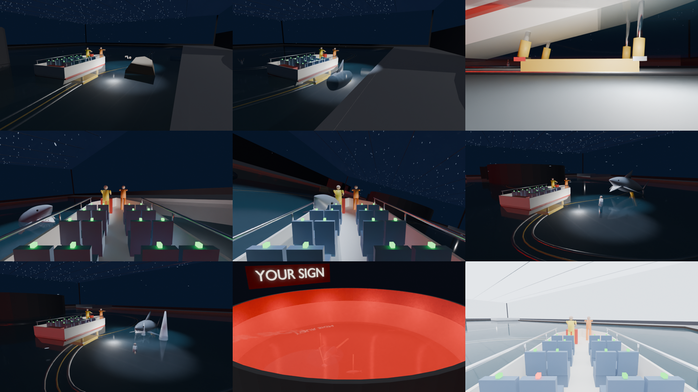

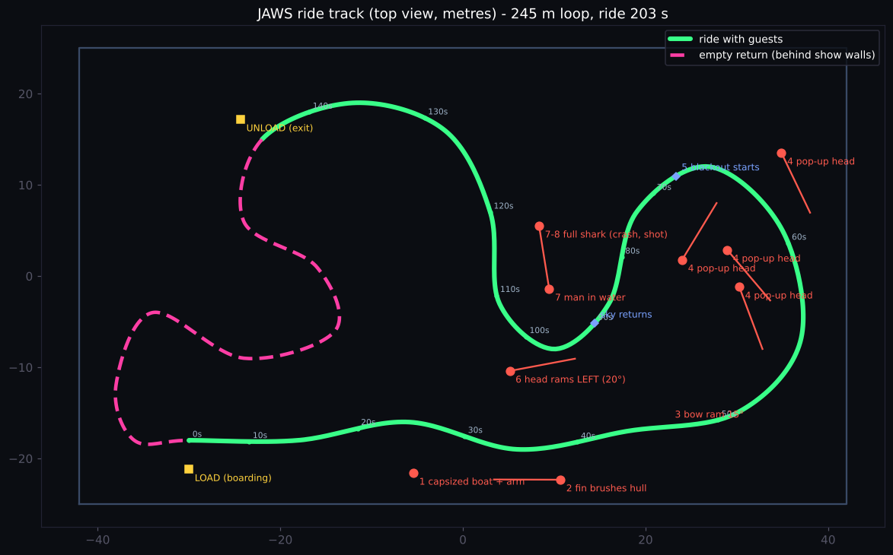 <em>Top view. Green = ride with guests, pink dashed = empty boat returning behind show walls.</em>

## Why I made this

When I saw the real JAWS ride, the shark was visibly fake. It's an outdoor ride in daylight, so guests can see exactly what they're looking at.

My idea was to **replace the existing JAWS ride with an indoor version that runs on illusion**. Instead of trying to build a perfect shark, I make the whole experience dark, so the brain fills in what the eyes can't see. My original notes (dated 18 Sep 2025) are in [`original_handwritten_notes.pdf`](original_handwritten_notes.pdf).

---

## Design reasoning: why each choice

### 1. Less shark, more boat

In the JAWS film, the mechanical shark kept breaking down in the ocean, so the shark is barely shown. Suspense and action carry the film, and it's scarier for it. I use the same idea in the ride. Guests **see less shark**, and the **boat itself lurches, tilts and twists** (6°, 15°, 20°) to make up for it. Motion is felt, not looked at, so it can't look fake the way a model can.

### 2. Why the boat is computer-controlled instead of driven

In the real JAWS ride, the shark pops up and grabs hold of the boat. For that to work, the operator has to **position the boat precisely** every time. If the boat isn't exactly where it should be:
- the boat can knock the shark;
- the shark bites at a spot where there's no boat;
- the teeth can come loose from hitting the boat.

Any of these turns a horror scene into a comedy scene.

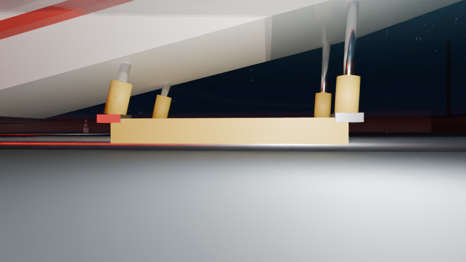

So in my version the boat is **fixed to an underwater rail on a preprogrammed course**, held by 4 hydraulic arms. The operator only *pretends* to steer: they turn a fake wheel, with engine noise and scripted chat with the crew. This:
- **removes human positioning error**, so every shark hits exactly where it's meant to;
- **standardises the ride**, so every guest gets the same show at the same timing;
- **gives full control** of speed, tilt and position, every time;
- **improves safety**, because the boat can't be steered into anything.

### 3. Darkness is the illusion

- **It's always night inside.** Ceiling screens show a night sky.
- **Eyes adapt first.** The ticket area and boarding rooms are dark, so guests' eyes are already adjusted before they board.
- **Darkness hides the animatronics.** Designed properly, they don't look fake, because guests only ever see a fin, a head or a splash for a moment, in a small pool of light.
- **It looks bigger than it is.** With poor visibility and chaos, people have no reference points, so they can't judge distance or size. A hall uses far less land than an outdoor lagoon but feels huge.

### 4. Only build what guests see

Most sharks are just a **fin** (the one brushing past the boat) or a **head** (the pop-ups and the ram from the left) on a hidden hydraulic arm. Only **one full shark** exists, for the scene where it leaves the water completely and later rolls over dead. This means fewer parts and lower cost. It also means each rig fits within about 6 m of the track, so the track can wind tightly.

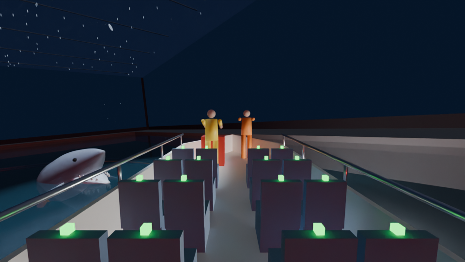

<em>A head-only rig: the cut end stays under water, so guests only ever see a head.</em>

### 5. Sprinkler rain

Sprinklers attached under the screen ceiling make it rain on the whole lagoon.
- **Water movement for free.** Falling drops stream past guests' eyes, so the slow boat **feels faster than it is**.
- **It hides the machinery.** Ripples on the surface cover the rail slot, the rig pits and the mechanisms, and the rain noise covers the hydraulic hum.
- **It looks cooler.**
- **The boat can stay slow.** A slow boat with lots of twisting and bending is safer and needs less track than a fast one.
- **The water is reused.** The sprinkler water comes from the same lagoon.

### 6. Screens and water together

The screens show fake shorelines, a sky and a bit of lightning. I took the idea from Jurassic World – The Ride, where a Mosasaurus on a screen inside a "tank" appears to pour water out toward the boat. That convinced me screens and water can work together if they're designed for it:
- the water is aimed away from the panels;
- the rain zone is kept back from the side walls;
- the panels are sealed;
- the hall is well ventilated.

**Lightning (planned, not yet in the model).** A flash lights everything for a split second. Timed with a pop-up, guests catch the shark's silhouette for about 0.1 s, then lose it in the dark, and the brain imagines something worse.

### 7. Separate unload and load stations

Guests get off at an **unload pier**. The empty boat then runs **behind show walls** back to the **load pier**, so people waiting to board never see the loop close or the end of the ride.

### 8. Safety first, even in the dark

- **3-point seat belts with sensors.** If even one belt opens, the show stops immediately:
  - the boat brakes;
  - every screen switches to **full daylight** and the house lights come on;
  - every shark and figure returns to its hidden home position.
  
  Darkness is part of the show, so the system takes no risks with it.
- **Guard rails** on both sides of the boat and on both piers, for emergencies.

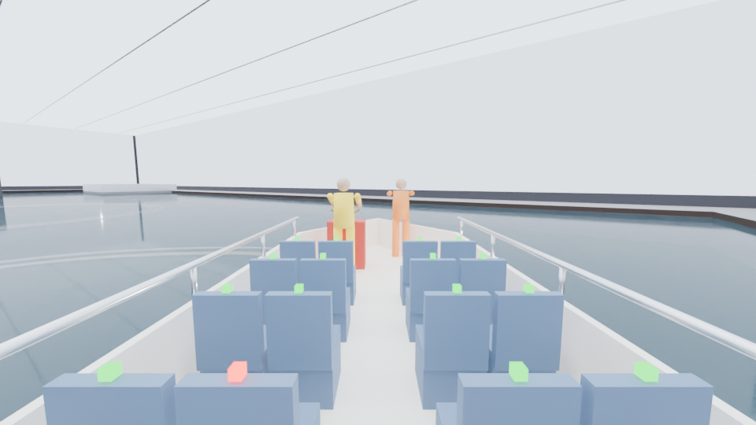

<em>One belt open (the red sensor light): boat stopped, screens and house lights at full daylight.</em>

### 9. Dolphin tank doubles as maintenance storage

At night the main lagoon is drained into the dolphin show tank, so engineers can service the track, arms and sharks **without fear of working in water**. During the day the water is pumped back and the dolphin rigs are serviced.

---

## Ride sequence (about 2 minutes with guests)

| | |
|---|---|
| 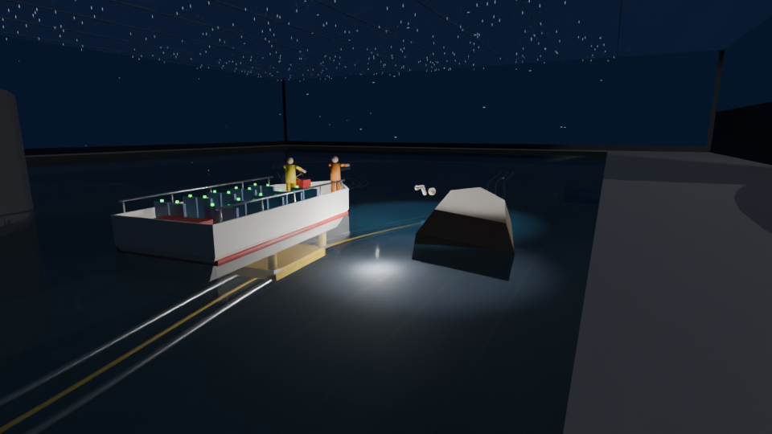 | **1. Capsized boat.** An arm comes up out of the water, tries to climb on, calls for help, and is pulled under. Only the arm and the top of the head show. |
| 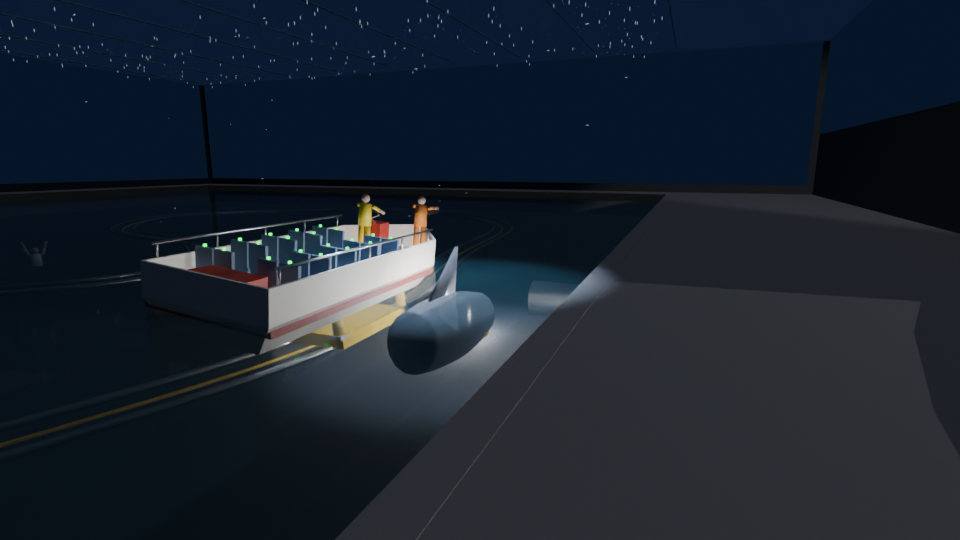 | **2. Fin brushes past.** A fin-and-back rig slides along the hull, and the boat tilts **6°** sideways (my notes say 5–7°). |
|  | **3. The driver "tries to rescue" him.** The bow lifts **15°** as if rammed, then drops. Under the water, the 4 arms do the work. |
|  | **4. Chaos.** The boat speeds up with erratic motion, and shark heads pop up here and there. |
| | **5. Blackout.** A narrator tells how our ancestors were taken by the shark and that someone is needed to end it. The side screens either follow the story or stay pitch black. |
| 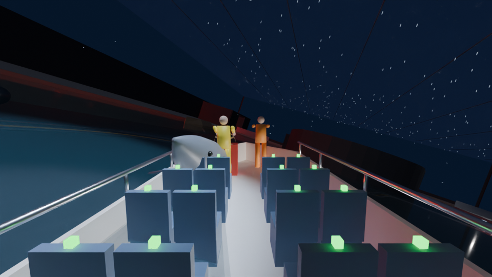 | **6. Sky returns.** The shark hits from the left, and the boat tilts **20° left**. |
| 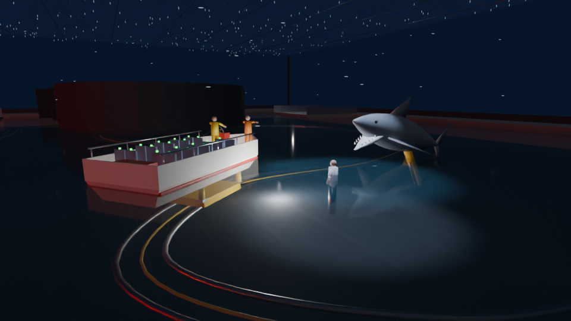 | **7. Man overboard.** While the boat stabilises, the shark hides. A second shark (the only full-body one) crashes onto a man in the water who fell off a boat. |
| 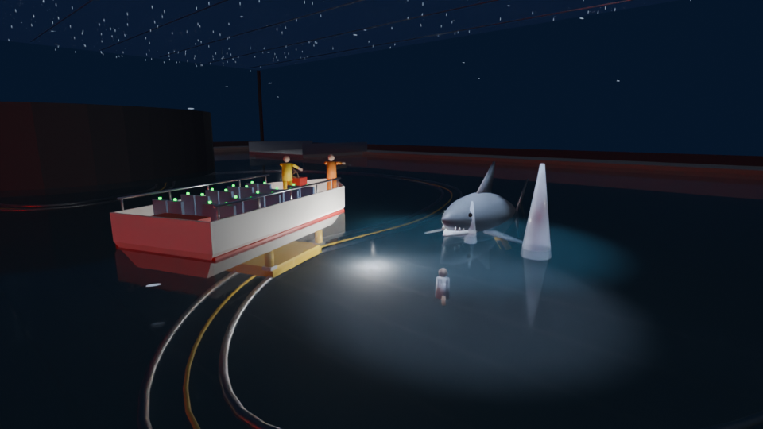 | **8. Staff fire.** A few shots miss (water jets burst near the shark), then it dies. The boat returns to the unload pier. |

**Outside the main hall:**

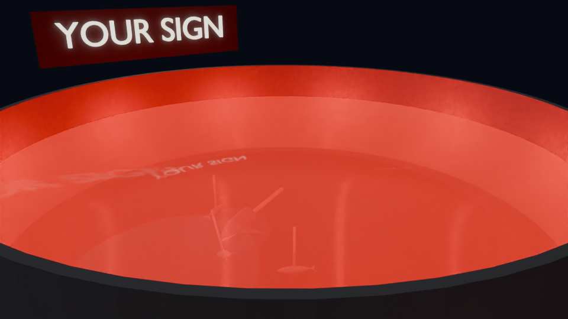

- A **dolphin night show** with animatronic dolphins. In the real park it runs 30 minutes. At the end the shark drags one dolphin under, red underwater LEDs light the water, and a light sign switches on.
- A **pool of real fish**, just for fun.

## Known challenges (from my notes)

- Water filtration.
- Wear and repairs where boats or water rub against animatronics.
- It may be unsuitable for children and faint-hearted people.
- A full screen ceiling is expensive.

## Engineering notes from the model

- **Motion base:** the bow-lift scene needs about **1 m of stroke** from the front arms. With only 1.5 m of water depth, single-stage cylinders don't fit, so this needs telescopic cylinders or a deeper trench under the rail.
- **Lagoon:** 84 m × 50 m and 1.5 m deep (about 6,300 m³ of water).
- **Track:** a 245 m loop, with a top speed of 2.9 m/s.
- **Rough cost:** about **US$50–90 M (₹450–800 crore)**. It could come down to about $35–40 M if built in India with simplifications. The biggest costs are the LED sky, the show building, and the hydraulic motion base on every boat. For comparison, the original JAWS ride cost $45 M in 1990.

## What's in this folder

| File | What it is |
|---|---|
| `original_handwritten_notes.pdf` | My original concept notes |
| `jaws_ride.py` | Blender script that builds and animates the whole park |
| `HOW_TO_RUN.txt` | Step-by-step for running it in Blender |
| `jaws_show_cue_sheet.csv` | Every show cue: time, device, action |
| `track_plan.png` | Top view of the track and where each scene sits |
| `images/` | One render per scene, taken from the Blender model |
| `preview_*.png` | Overview sheets of the renders |

**To run it:** open Blender (tested on 5.x) and go to the Scripting tab. Open `jaws_ride.py` and press Run Script, then press Space to play. The settings at the top of the script switch to maintenance mode, simulate a belt fault, change the track shape or choose guest view versus engineering view.

## How this was made: AI disclosure

**The concept, the scene sequence, the illusion approach, the safety logic and all the design reasoning above are mine.** That includes computer-controlled boats, less shark with more boat motion, partial sharks, separate load and unload stations, sprinkler rain and screens with water.

**All the Blender Python code was written by Claude, Anthropic's AI assistant, because I don't know how to write Blender scripts.** Claude also:
- chose the dimensions, since my notes had none;
- designed the show-control structure and the hydraulic-arm calculations;
- wrote the narrator lines;
- produced the cost estimate;
- helped write this README.

I directed every change and reviewed the result in Blender.
